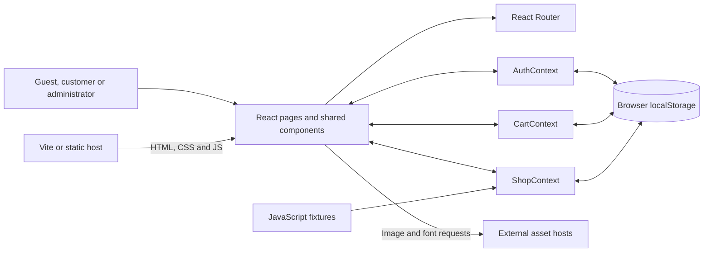
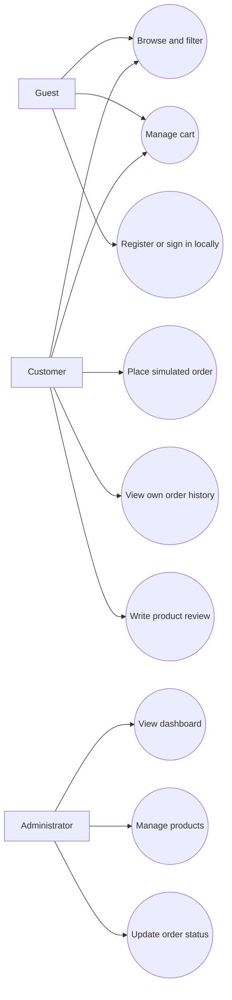
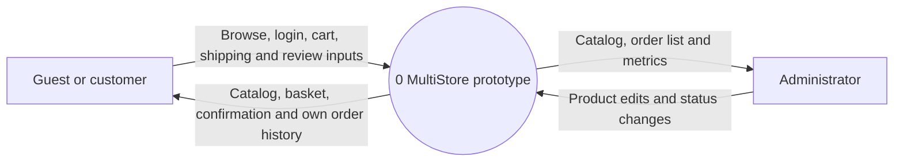
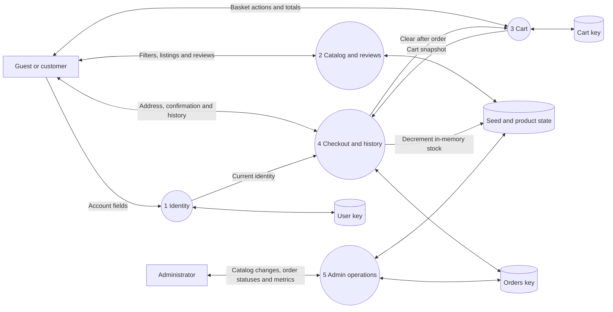
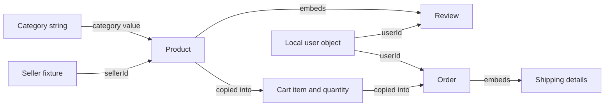
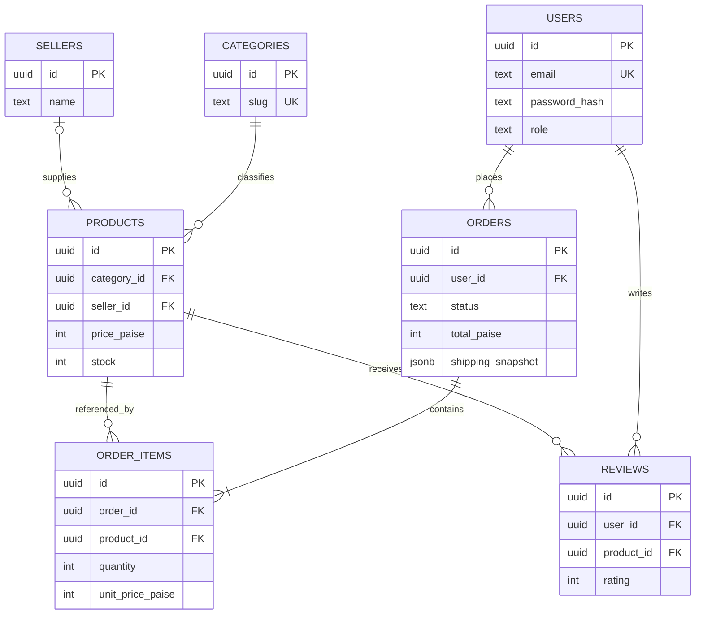
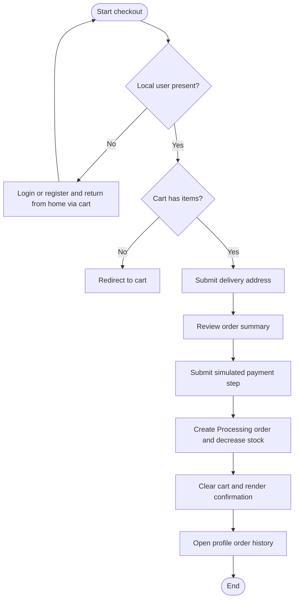
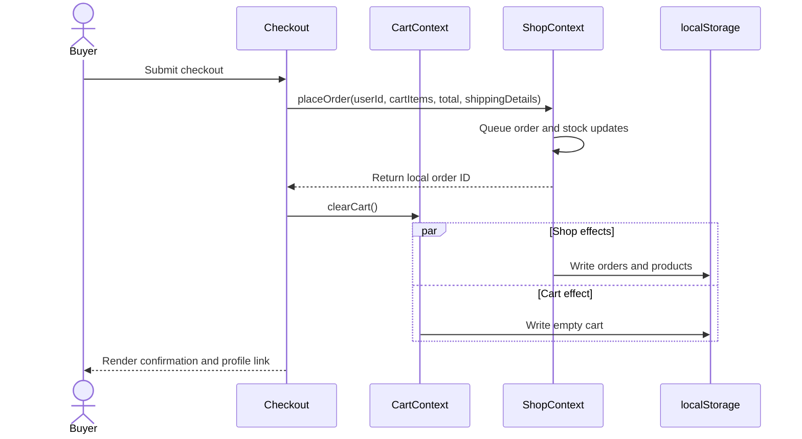
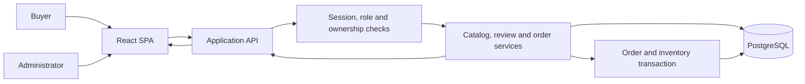

# MultiStore — final-year project analysis and completion plan

**Suggested academic title:** MultiStore: Design and Evaluation of a Multi-Category E-Commerce Prototype  
**Repository:** fathima-shaba/Multi- · **Audited checkout:** `a763e9c` · **Audit date:** 25 November 2026

## 1. Project overview and evidence

MultiStore is a React storefront prototype for discovering products, comparing listings, assembling a cart, placing simulated orders, writing reviews and managing products and order status. The interface uses Indian rupees in the storefront and Indian-style address terminology. The intended audience includes shoppers and store operators. Seller attribution is part of the catalog presentation. A seller account or seller workflow would be additional scope.

The project models a problem common to small retailers that manage product information, orders and stock separately: shoppers may lack a consistent catalog and order history, and staff may have to reconcile stock and order status manually. This is the academic problem framing. The repository provides no user interviews, field study or measured business outcomes.

**Objectives:** Provide a navigable catalog with meaningful filters, support a complete simulated purchase, show buyer order history, provide staff controls for catalog and order status, and evolve the prototype into a system with durable data and server-enforced permissions.

**Current scope:** Browser-based catalog, cart, reviews, local accounts, simulated checkout, profile history, product administration and order administration. **Proposed submission scope:** A durable, authenticated, single-operator storefront with seeded seller attribution and simulated or cash-on-delivery checkout. A true multi-vendor system, live payments, delivery tracking and refunds can be presented as future work.

### Evidence and verification

- The local Git remote matches the supplied URL. GitHub's public listing matches the tracked repository layout. The direct Git remote HEAD request could not connect, so remote commit parity is unverified. [Public repository](https://github.com/fathima-shaba/Multi-)
- Read the route tree, providers, page and component source, seed data structure, style definitions, project configuration, lockfile metadata and README. The README is React/Vite starter documentation. The application name in the header is **MultiStore**. Both the npm package and browser title use **multi**.
- Local Node **24.16.0** and npm **11.13.0** ran the project. PowerShell blocked `npm.ps1`, so the audit used `npm.cmd`.
- Oxlint reported **17 warnings** and no errors. Warnings covered unused variables/imports and Fast Refresh exports. A fresh Vite build succeeded in a temporary output directory. Its JS was **608.31 kB minified / 109.22 kB gzip**, and CSS was **35.79 kB / 6.81 kB gzip**. Vite flagged the JS chunk size. The existing ignored `dist/` was left intact and references different bundles. Its root listing also lacks the three current banner files.
- Vite started on loopback. HTTP GETs for `/` and `/product/1` returned **200**. HTTP smoke tests establish delivery of the SPA shell. The feature and defect descriptions below are grounded in source inspection. Browser interaction and deployment verification are documented separately at the end of this report.
- Imported the seed module directly in Node: **475 products, 19 category strings, five seller records**, and zero products with seeded review bodies. No credentials are reproduced in this report.

## 2. Pages, navigation and roles

All routes below are declared in `src/App.jsx`. The global navbar and footer wrap every page, including administration.

| Route | Source under `src/pages/` | Purpose and current behavior |
|---|---|---|
| `/` | `Home.jsx` | First ten category shortcuts, three local banners with manual arrows and five-second rotation, trust copy, and up to six cards per rail. Rails cover deals above 40% discount, electronics, fashion, home, items below ₹999 and beauty. Deals countdown is static. An unused new-arrivals selection has no rendered rail. |
| `/shop` | `Shop.jsx` | Product grid and count, category query parameter, category sidebar, minimum/maximum price, a single minimum rating, a single minimum discount and multi-select brand filtering. Offers price ascending/descending, popularity and newest sorting. Includes clear filters and empty results. Category chips are static. |
| `/product/:id` | `ProductDetails.jsx` | Product lookup and missing-item recovery, image, price and rating, offers, delivery/service copy, seller attribution, highlights, description, template specifications, static Q&A, reviews and up to four same-category products. Add to Cart is wired. Buy Now, wishlist and PIN check are unfinished. |
| `/cart` | `Cart.jsx` | Empty state, item links, quantity controls, removal, MRP and discounts, shipping calculation and checkout navigation. Save for Later is inert. |
| `/checkout` | `Checkout.jsx` | Guest redirect to login, empty-cart redirect to cart, address form, editable address and summary steps, payment-method display, local order submission, confirmation and profile link. Login appears as completed for a signed-in user. UPI, card and COD choices have no processing logic. |
| `/profile` | `Profile.jsx` | Guest redirect, current name/email/role and history filtered by current user ID. Shows item snapshots, date, status, shipping summary and total. Profile editing and live shipment tracking are absent. |
| `/login` | `Login.jsx` | Email and password form, mock sign-in, fallback error UI, link to registration and success navigation to home. |
| `/register` | `Register.jsx` | Name/email/password form creates a local customer session, returns home and links to login. No account registry or password verification exists. |
| `/admin` | `admin/Dashboard.jsx` | Role-gated layout and sidebar, order count, summed order totals, catalog count, stock at or below five and latest five orders. Revenue includes cancelled/unpaid simulations. |
| `/admin/products` | `admin/ManageProducts.jsx` | Product listing and add/edit modal for name, description, price, category, image URL and stock. Delete acts immediately. Optional display fields remain outside the form. |
| `/admin/orders` | `admin/ManageOrders.jsx` | Lists order ID, customer ID, date, total and status. Staff UI can select Processing, Shipped, Delivered or Cancelled. Includes empty table state. |

**Navigation.** The brand returns home. The top bar has a search field, login or account dropdown, Become a Seller, Wishlist and cart count. The second bar links Home, eleven categories and the remaining eight under More. Home rails, cards and product breadcrumbs link into catalog routes. The account menu exposes profile, Orders, an admin link for the admin role, and logout. The footer has about, help, policy and social sections. `Navbar.jsx`, `Footer.jsx` and `ProductDetails.jsx` link to undeclared paths: `/orders`, `/seller-dashboard`, `/wishlist`, `/seller/:id`, `/about`, `/help` and `/policy`. With no wildcard route, unmatched paths leave the central content empty while the shell remains. The footer social destinations and product offer links point to fragments. Footer badges are display-only.

**Roles and authorization.** Guest is the absence of a session. Customer is role `user`; administrator is role `admin`. Guests browse and use the cart; a local user object enables checkout, profile and review authoring. `AuthContext.jsx` grants admin for a hardcoded credential comparison. Otherwise, a nonempty email/password combination creates a new customer identity, subject to the form's browser checks. Registration creates a local customer object and ignores the password. Logouts remove the user key and return home. The admin layout checks the local role and redirects other users to home. This is a UI guard. The browser itself supplies the identity, role and records. Seller names and ratings come from fixtures.

## 3. Technology stack and deployment

| Layer | Actual repository |
|---|---|
| Frontend | JavaScript ES modules and JSX, HTML5, plain CSS, React and React DOM ^19.2.8, React Router DOM ^7.18.3, Lucide React ^1.37.0. Type packages are installed as tooling; source files are JavaScript. |
| State | React Context, state/effect hooks, memoized shop filtering, URL query parameters and Web Storage `localStorage`. |
| Backend / database | No application backend, API server, database driver, schema, migrations or hosted database configuration found. Node executes development tooling. |
| External resources | Product/category and empty-state image URLs on `source.unsplash.com`, Google Fonts Inter CSS and Wikimedia payment logos. These are asset requests. The code has no payment, delivery, identity or email service integration. |
| Tools | npm lockfile, Git, Vite ^8.2.2, Vite React plugin ^6.1.0 and Oxlint ^1.79.0. Scripts are `dev`, `build`, `lint`, `preview`. |
| Deployment | Build via `npm run build`; serve fresh `dist/` over HTTP(S) with SPA history fallback to `index.html` for UI routes and normal static asset handling. Root-relative assets assume root hosting unless the Vite base, router and asset references are coordinated. No tracked hosting or CI configuration. |

## 4. Architecture, request flow and repository map

`index.html` provides the root and loads `src/main.jsx`. The entry point mounts React StrictMode and nests the Authentication, Shop and Cart providers. `App.jsx` mounts BrowserRouter, shared navigation and nested admin routes. Pages and reusable components read provider state and call provider functions directly.

On an initial URL or hard refresh the host serves the HTML shell and browser loads JS/CSS. React Router resolves the URL locally. A user interaction calls a component handler, which updates local state or calls a provider. React re-renders affected consumers and effects serialize relevant state into storage. On initialization, auth, orders and cart try to parse stored JSON. Product initialization writes the seed and starts from it on each provider remount. Images and fonts load as separate browser resource requests. Checkout produces a local object and ID through a JavaScript call. There is no HTTP order request or database response.

| Path | Responsibility |
|---|---|
| `package.json`, `package-lock.json` | Scripts, dependency ranges and resolved dependency tree. |
| `vite.config.js`, `.oxlintrc.json`, `.gitignore` | React build plugin, lint rules and ignored generated/development files. |
| `index.html`, `src/main.jsx`, `src/App.jsx` | Browser entry, provider composition and routing/layout. |
| `src/context/{Auth,Cart,Shop}Context.jsx` | Mock identity and role; cart mutations and totals; catalog, reviews, orders and stock. |
| `src/pages/`, `src/pages/admin/` | Customer and administrator page components and their CSS. |
| `src/components/` | Navbar, Footer, ProductCard and ReviewSection plus component styles. |
| `src/data/mockData.js` | Static category, product and seller fixtures. Seller export is imported but unused by ShopContext. |
| `src/index.css`, `src/App.css` | Global styles, typography, utilities and app-level layout. |
| `public/`, `src/assets/` | Public banners and icons; source assets including starter React/Vite images and hero graphic. Home uses the public banners. |
| `README.md`, ignored `dist/` | Starter instructions; generated local distribution. |

## 5. Module inventory

“Implemented locally” describes a wired browser operation seen in source. A partial module has a demonstrated source-level gap in persistence, business rules or interaction.

| Module | Purpose and features | Input → output and implementation | Status and evidence |
|---|---|---|---|
| Shell and navigation | Route users, expose categories, account and cart | URL, role, categories and cart count → layout, links and cart badge | Partial. Placeholder links and missing routes. `App.jsx`, `components/{Navbar,Footer}.jsx` |
| Home merchandising | Surface groups and promotions | Fixtures → filtered, sliced card rails and rotating banners | Implemented locally; deals timer and trust statements are static. `Home.jsx` |
| Catalog | Browse, filter and sort | Query category, price/rating/discount/brands, sort choice → list | Partial. Price/category/filter logic exists. Popularity uses review array length; seeded `createdAt` is absent; only first five available brands appear. `Shop.jsx` |
| Product details | Present product and add to cart | Route ID and PIN input → product or missing-item view, recommendation cards, optional cart mutation | Partial. PIN input has no checker; seller, offers and buy-now gaps. `ProductDetails.jsx`, `ProductCard.jsx` |
| Reviews | Collect and show buyer feedback | Signed-in identity, 1–5 selection and nonblank text → embedded review and mean rating | Partial. No purchase/duplicate rule; simulated counts stay stale; reload resets reviews. `ReviewSection.jsx`, `ShopContext.jsx` |
| Authentication | Create, use and clear demo identity | Form fields → local object and redirects | Simulation. No durable accounts, secure credential verification or real authorization. `AuthContext.jsx`, `Login.jsx`, `Register.jsx` |
| Cart and pricing | Maintain basket and price breakdown | Product snapshot and quantity → totals, count and approximate delivery fee | Partial. Usable controls but stock enforcement is incomplete and cart is shared across local accounts. `CartContext.jsx`, `Cart.jsx` |
| Checkout and order creation | Collect shipping info and simulate purchase | Identity, address and cart → local order with Processing status, stock decrement and cart clear | Partial. Payment fields ignored, email text is informational, total display changes after cart clear. `Checkout.jsx`, `ShopContext.jsx` |
| Profile and order history | Display current identity and their orders | Current user ID and stored orders → filtered history | Partial. Fresh login changes customer ID; currency and PIN display are inconsistent. `Profile.jsx` |
| Admin overview | Summarize operations | Catalog and orders → four metrics and five recent orders | Implemented locally. Revenue label overstates actual collections. `admin/Dashboard.jsx` |
| Admin product management | Add, edit and delete | Form data and product ID → catalog updates | Partial. Changes vanish on reload; constraints and item availability handling are incomplete. `admin/ManageProducts.jsx`, `ShopContext.jsx` |
| Admin order management | Review orders and set status | Order ID and selected status → updated persisted order | Partial. No transition rules, audit trail, restock or buyer notification. `admin/ManageOrders.jsx`, `ShopContext.jsx` |
| Fixtures and browser persistence | Supply initial catalog and preserve local state | JS fixture arrays and serialized JSON → hydrated providers | Partial. Product writes are overwritten at startup; stored key reads have no guard. `src/data/mockData.js`, `src/context/` |

## 6. Data design

### Actual browser data

There are no DB tables, physical PK/FK constraints, SQL queries or collection definitions. The table documents runtime JavaScript shapes. IDs referenced across objects are logical links and have no referential enforcement.

| Store / entity | Fields and data types | Identifiers and persistence |
|---|---|---|
| `user` | `id, name, email, role` strings. | One local JSON object; regular IDs are timestamp strings, and admin has a fixed ID. Identity clears on logout. |
| `products` | Strings `id, name, description, image, category, brand, sellerId, sellerName, deliveryInfo, returnPolicy, warranty`; numbers `price, originalPrice, discount, stock, reviewCount, sellerRating`; `rating` is a string in the seed and a number after review/creation; `bankOffers` string array; `reviews` object array. | Product `id` identifies lookup and cart merging. Optional seed fields may be absent on admin-created entries. JSON is written, but the provider initializes from seed every time. |
| Categories | Array of strings. | Product `category` matches a string; no category IDs. |
| Sellers | `id, name` strings, `rating` number. | Seed identifiers correspond to product `sellerId`. Seller data is duplicated on product rows. No seller account/store. |
| Review | `id, userId, userName, text, date` strings; `rating` number. Date is ISO serialized. | Embedded in a product; timestamp-based review ID, logical user link only. |
| `cart` | Array of product snapshots plus numeric `quantity`. | Product ID used as line key. Browser-origin scope, with no user association. |
| `orders` | `id, userId, date, status` strings; numeric `total`; `items` array of cart snapshots; `shippingDetails` object. | Order ID is timestamp-based. Logical order-to-user relation and embedded line contents. |
| Shipping snapshot | `name, phone, pincode, locality, address, city, state` strings. | Embedded in order; profile erroneously looks for `zipCode`. |

### Proposed relational design for the submission

Suggested PostgreSQL model, to be created through migrations. Use UUID primary keys, server-generated timestamps and INR amounts as integer paise. Keep shipping and line details as order snapshots so later catalog and address edits leave purchase history intact.

| Table | Proposed columns and relationships |
|---|---|
| `users` | `id` UUID PK, `name` text, `email` text unique after normalization, `password_hash` text, `role` constrained text, `created_at` timestamptz. |
| `categories` | `id` UUID PK, `name` text unique, `slug` text unique. One category has many products. |
| `sellers` | `id` UUID PK, `name` text, optional rating numeric. Attribution only at the proposed submission scope. One seller can supply many products. |
| `products` | `id` UUID PK, `category_id` FK, optional `seller_id` FK, `name,description,brand,image_url` text, `price_paise,stock` nonnegative integers, `active` boolean, `created_at` timestamptz. Archive instead of deleting purchased items. |
| `orders` | `id` UUID PK, `user_id` FK, constrained `status` and `payment_method`, `total_paise,shipping_paise` integers, `shipping_snapshot` validated JSONB, `created_at` timestamptz, `idempotency_key` text unique per user. |
| `order_items` | `id` UUID PK, `order_id` FK, `product_id` FK, `product_name` text snapshot, `unit_price_paise,quantity` integers with positive quantity. |
| `reviews` | `id` UUID PK, `product_id,user_id` FKs, `rating` smallint constrained 1–5, `body` text and `created_at` timestamptz. Optional one-review-per-user/product constraint and order eligibility check. |

A server-backed cart, saved addresses and payment transaction records can be added if cross-device cart, saved addresses or gateway processing enters scope. For the proposed first release, an anonymous local cart can store only item IDs and quantities.

## 7. End-to-end workflow by role

1. **Guest:** Open Home, pick a category, filter or sort, open a product, add it to cart and change the quantity. Checkout or profile redirects to login. Registration/login sends the user to home, so the user reopens Cart to continue. Review authoring shows a login prompt. Admin paths redirect to home.
2. **Customer:** Use register or the demo login, browse and optionally submit a star rating and review. Open Cart, select Place Order, complete delivery address, review the order, select a displayed payment option and submit. The provider stores a Processing order, decrements in-memory inventory and clears Cart. Track Order opens profile history. A fresh mock login creates a new ID and can lose access to the old history.
3. **Administrator:** Use the designated local demo sign-in and open Admin Dashboard from the account menu. Review metrics, open Products for add/edit/delete and open Orders to update a status. In the same browser origin, orders can survive refresh while catalog changes reset. The status update can be inspected in the original buyer session if that identity is retained. Admin can also browse customer pages.
4. **Seller:** Seller metadata appears on products. There is no seller workflow or role.

## 8. Existing and proposed system

| Aspect | Illustrative traditional approach | MultiStore prototype | Proposed completed release |
|---|---|---|---|
| Discovery | In-person, phone inquiry or scattered product lists | Unified categorized storefront, filters and merchandising | Searchable, paginated catalog with curated product information |
| Purchase | Orders through messages or manual records | Local address and checkout simulation | Server-validated order and consistent stock adjustment |
| Tracking | Customers contact the operator | Profile shows stored local order status | Stable account identity and shared order history |
| Administration | Spreadsheet/manual inventory and tracking | Staff UI for products, status and overview | Durable role-controlled updates and a traceable order lifecycle |

The prototype's distinguishing combination is a multi-category catalog with seller attribution, reviews, checkout, history and an admin view within a single React app. The completed design would reduce duplicate entry and keep catalog, stock and orders consistent across users. A market comparison and quantitative evaluation would require separate evidence.

## 9. Completion audit

Priority definitions: **Critical** blocks using real customer data or trusting access control; **High** breaks core correctness or the demonstration; **Medium** impairs discovery, usability or maintainability; **Low** is polish. These priorities are evaluator judgments.

| Priority | Finding | Evidence and effect |
|---|---|---|
| Critical | Mock login, embedded admin credential and browser-controlled role | `AuthContext.jsx`, `admin/Dashboard.jsx`. Browser UI has sole authority; submission data should be synthetic until server controls exist. |
| Critical | No trusted persistence or order boundary | `ShopContext.jsx`, `CartContext.jsx`, repository structure. Price, inventory, order data and role are client-owned; no shared DB, ownership verification or atomic checkout. |
| High | Product resets and inconsistent snapshots | `ShopContext.jsx` seeds on initialization; `CartContext.jsx` keeps full snapshot and orders retain their copies. Editing/deleting can leave obsolete cart records. Reviews and inventory reset across reload. |
| High | Unstable user identity and shared cart/PII | `AuthContext.jsx`, `CartContext.jsx`, `Profile.jsx`. Re-login can hide order history; cart survives account changes; full shipping address and phone are stored in origin-readable JSON. |
| High | Checkout does not charge or send mail | `Checkout.jsx`. Payment selection is discarded, card is selected by default, Pay submits a local order, and summary promises email without an integration. Mock checkout is suitable only when labeled. |
| High | Confirmation price is recomputed after cart clear | `Checkout.jsx`. Stored order uses pre-clear total; success UI reads the emptied cart and shipping logic produces ₹40. Profile/admin currency labels use dollars. Profile reads `zipCode`, checkout saves `pincode`. |
| High | Weak inventory and lifecycle rules | `CartContext.jsx`, `ShopContext.jsx`, `ManageProducts.jsx`, `ManageOrders.jsx`. Repeated add bypasses cumulative limits, cart uses stale stock, checkout can let stock go negative, negative form values lack a lower bound, status can jump arbitrarily, cancellation does not restock. |
| High | Broken visible destinations and missing 404 | `App.jsx`, `Navbar.jsx`, `Footer.jsx`, `ProductDetails.jsx`. Seven unmatched destination patterns are listed in section 2. Product not-found view exists for a missing ID. |
| High | Fragile demonstration assets and stale build | `mockData.js`, `Home.jsx`, empty-state pages and `dist/`. External product/category images have no fallback; exact accessibility can depend on network. Current ignored build differs from source and lacks local banner files in its root listing. |
| High | Storage read and write failures lack recovery | The three providers. Corrupted JSON can prevent rendering; writes can fail when storage is unavailable or full. Order, inventory and cart update separately. |
| Medium | Search and action placeholders | `Navbar.jsx` search has no handler. `ProductCard.jsx` heart is a stub; `ProductDetails.jsx` heart, Buy Now, PIN check and static Q&A lack underlying behavior. Cart Save for Later, shop chips, fragment links and footer badges are unfinished. |
| Medium | Category encoding and filtering semantics | `Home.jsx` Home Essentials and `ProductDetails.jsx` breadcrumbs interpolate raw category strings; `&` splits the query. Category changes retain selected brands. Clear All does not clear the category or sort. Price bounds can conflict. Shop default max is finite. |
| Medium | Mock counts and promotional claims | Seed reviewCount and rating are independent of review bodies. `addReview` changes average but leaves count. Popularity uses actual review array length and newest uses a missing field. Timer, corporate details, offers, returns, authenticity, delivery and payment badges are unverified fixture or display copy. |
| Medium | Validation and administration | `Checkout.jsx` prefills demo phone and uses required text fields without phone/PIN constraints. Auth lacks meaningful account rules; reviews lack length/eligibility constraints. Admin deletes instantly; missing fields make product detail sparse. Dashboard revenue sums all orders. |
| Medium | Accessibility and responsiveness risks | `Navbar.css`, `ProductCard.css`, `Shop.jsx`, `Admin.css`. Hover dropdowns/quick actions, nested buttons in product links, clickable non-button categories and wide tables warrant keyboard, touch and narrow-viewport testing. Styles contain breakpoints from 480 to 1440 px; actual viewport coverage is unverified. |
| Medium | Delivery labels and totals disagree | `Cart.jsx`, `Checkout.jsx`, `ProductCard.jsx`. Rule charges ₹40 at subtotal ≤ ₹500 yet individual lines display free delivery. Checkout summary computes a discount but omits its line, and headings count distinct rows rather than units. |
| Medium | Deployment and performance gaps | `vite.config.js`, `App.jsx`, `Shop.jsx`. SPA fallback and base-path configuration depend on host. Static import of the full catalog plus rendering all matched cards causes a large initial bundle/grid. No tracked deployment pipeline or production monitoring was found. |
| Low | Starter documentation and cleanup | `README.md`, `index.html`, Oxlint output. Missing setup, test and demo instructions; generic title, unused imports/state and starter assets. |

**Operational classification.** The wired baseline includes route rendering, banner controls, price sorting, cart add/remove/quantity, mock session creation/logout, local order writes, order-status selection, profile filtering and initial admin metrics. Persistence, payment, inventory, authorization and action placeholders prevent calling the complete storefront production-ready. The source shows no real payment, email, database or API integration to test.

## 10. Completion roadmap

| Step | Files to change or add | Expected result and acceptance check |
|---|---|---|
| 1. Establish stable demo | `Checkout.jsx`, `Profile.jsx`, admin views, `Home.jsx`, `ProductDetails.jsx`, `App.jsx`, `Navbar.jsx`, `Footer.jsx`, `README.md` | Snapshot confirmed total, use one INR formatter and PIN field, label simulation, remove unsupported claims/actions or give them real targets, encode category query, add 404 and route Orders to profile. Demo subtotal, confirmation, history and admin agree. |
| 2. Stabilize interim state and assets | Providers under `src/context/`, `src/data/mockData.js`, `public/`, card/detail styles | Validated, versioned seed-on-first-use storage for demo fixtures, safe parsing/fallback, deterministic locally hosted or licensed sample imagery and consistent availability. Browser reload preserves catalog edits and reviews in the interim build. |
| 3. Establish persistence and API | New `server/`, `server/db/migrations/`, `server/db/seed/`, `src/api/`, `.env.example`, README and ignore rules | Proposed Node service (Express is one option) and PostgreSQL; migrate and seed with stable identifiers. Design catalog list/detail endpoints and shared error format; runtime credentials live only in server configuration. Independently validate API and migrations. |
| 4. Implement identity and roles | New server auth/session and authorization modules; `AuthContext.jsx`, login/register, `App.jsx`, profile and admin layout | Unique users, salted password hashes, secure server sessions, stable IDs, server-side role/ownership checks, session expiry and request limits. Follow CSRF controls for cookie authentication. Remove hardcoded mock credential. Customer re-login retains history; staff-only API rejects guests/customers. |
| 5. Finalize ordering | New order/inventory service and schema tests; `Checkout.jsx`, `CartContext.jsx`, `ShopContext.jsx`, `Profile.jsx`, `ManageOrders.jsx` | Submit IDs, quantities and validated address; resolve current prices and stock server-side. Create order/items and decrement stock in one transaction, handle retries idempotently, implement controlled status transitions and restock policy. Keep checkout clearly simulated or COD. |
| 6. Complete storefront/admin | `Shop.jsx`, `Navbar.jsx`, `ProductDetails.jsx`, `ProductCard.jsx`, `ReviewSection.jsx`, admin modules, API endpoints | Search query and pagination, actual sort signals, functional Buy Now or removed action, stock-aware cart and accessible filters. Persist reviews with coherent counts; require admin validation and confirmation for product archiving. Wishlist and seller onboarding remain optional expansion. |
| 7. Validate and deploy | Suggested `tests/`, `package.json`, `vite.config.js`, host routing configuration, CI config and README | CI builds, lints and runs tests. Verify local and hosted deep links, assets, mobile layout, account separation, backups and clean restore. Capture dated release evidence for the evaluation. |

## 11. Software and hardware requirements

- **Development:** Windows, macOS or Linux, Git, editor, shell, npm and a modern browser. The installed Vite package declares Node `^20.19.0 || >=22.12.0`; Node 24.16.0 was tested here. Run `npm ci` from the project root and then `npm run dev`. On locked-down PowerShell, use `npm.cmd ci` and `npm.cmd run dev`.
- **Demo/runtime:** Serve the built SPA through a local or static web server with history fallback. Modern Firefox, Chromium/Edge or Safari with JavaScript and browser storage enabled. Network or local equivalents are needed for current remote images/fonts/logos. A projector or screen share is sufficient for presentation.
- **Hardware estimate:** Laptop with a two-core CPU, 4 GB RAM and about 1 GB free disk for development tools/project is a practical starting point. 8 GB RAM is preferable for browser, editor and a proposed local DB running together. These are planning estimates; no formal minimum hardware benchmark was run.
- **Proposed server-backed release:** Node service, PostgreSQL, persistent volume or managed DB, HTTPS host, environment configuration and test dataset. Keep a rehearsed local environment available for the college demo.

## 12. Testing

No tracked automated test suite, coverage configuration, test script or CI workflow was found. Static lint and compile checks were executed. Full feature, cross-browser, mobile, security and load coverage has not been established.

| ID | Type | Scenario | Expected target behavior |
|---|---|---|---|
| F01 | Functional | Home carousel arrows and timed progression | Three banners render and wrap; controls work via keyboard. |
| F02 | Functional | Direct category link for Home & Furniture | Full category survives encoding and matches products. |
| F03 | Functional | Search, filter, sort and empty results | Stable query/navigation, valid bounds, correct counts and clear recovery. |
| F04 | Functional | Missing product and unknown path | Dedicated recovery view and store link. |
| F05 | Functional | Add twice, decrement to zero and remove | Line merges correctly, cannot exceed stock, disappears at zero. |
| F06 | Functional | subtotal ₹499/₹500/₹501 | Fee and displayed total agree across all pages under the documented rule. |
| I01 | Integration | Place order with synthetic address | One Processing order persists with line and shipping snapshots; confirmation equals stored history total. |
| I02 | Integration | Reload after edit, review and purchase | Catalog edits, reviews, order history and stock survive expected lifecycle. |
| I03 | Integration | Repeat request, parallel shoppers on final unit | Idempotent retry and one successful allocation. Inventory stays nonnegative. |
| I04 | Integration | Cancel eligible order and retry cancellation | Valid transition, restock once, status history available. |
| I05 | Integration | Re-login and open order history in a clean session | Owner sees their own previous orders under stable identity. |
| V01 | Validation | Bad email, duplicate account, blank/malformed PIN/phone | Clear field feedback and server rejects invalid payloads. |
| V02 | Validation | Negative price/stock, invalid rating, long review | Server rejects invalid ranges and lengths consistently. |
| S01 | Security | Guest/customer requests admin API | Unauthenticated and unauthorized requests denied. |
| S02 | Security | Customer requests another customer's order | Ownership enforced independently of UI. |
| S03 | Security | Modify client price/role or submit repeated sensitive requests | Server uses authoritative values and applies session, authorization and rate checks. |
| S04 | Security | Inspect production build and local storage | No server secrets or unnecessary address data in client artifacts/storage. |
| U01 | Usability | Touch/keyboard at 360, 768 and 1366 px | Header, filters, dropdowns, modals and tables remain operable and readable. |
| D01 | Deployment | Reload direct URLs and load with third-party assets unavailable | SPA resolves intended routes; local assets/fallback images render. |

Use unit tests for pricing/validation/status rules, browser tests for checkout and admin workflows, API integration tests against a disposable database, and focused manual accessibility and responsive checks. Record expected vs actual results and commit ID for the submission.

## 13. Mermaid diagrams

### Current system architecture

### Current use case equivalent

### Current DFD Level 0

### Current DFD Level 1

### Current logical data model

The arrows show identifiers or embedded records in JavaScript. The product-to-seller and account-to-order links are conventions in browser data.

### Proposed physical ER diagram

Current links are documented in section 6. This diagram represents the proposed database for the completion phase.

### Current checkout activity

### Current checkout sequence

### Proposed system workflow

## 14. Presentation-ready academic content

| Topic | Slide or speaker-note content |
|---|---|
| Abstract | MultiStore is a multi-category e-commerce prototype built with React and Vite. It models the path from product discovery to simulated order placement, order history and staff administration. Browser state and seeded products enable a local demonstration. The evaluation identifies gaps in identity, data durability, stock consistency and checkout. A completion design adds a validated API, relational persistence, server-managed access and transactional inventory. |
| Introduction | Online ordering connects product discovery, basket pricing and fulfillment. A storefront also requires a staff view to maintain the catalog and update order status. MultiStore presents both views in one application. |
| Problem statement | When product information, inventory and orders are managed independently, customers can see stale availability and staff must reconcile records manually. Design one workflow linking the catalog, cart, order and operational update. |
| Objectives | Make product discovery interactive, implement a simulated checkout, record customer order history, provide staff controls, and validate a migration to durable storage. |
| Existing system | Use the illustrative manual workflow in section 8; describe fragmented catalogs, phone/message orders and spreadsheet stock. Present as a baseline scenario rather than a surveyed organization. |
| Proposed system | Show a shopper/admin SPA, a server-side API and PostgreSQL. Authenticated users submit orders; the server verifies stock and price; personnel update status through controlled operations. |
| Literature survey | Study Fielding for client/server and REST constraints; Gray and Reuter for transaction correctness, concurrency and recovery; OWASP ASVS for verifiable authentication, authorization and input controls. Include how each source informs a concrete design choice. References are listed below. |
| Methodology | Describe the implemented prototype through component, route and data inspection and a local smoke test. For completion, propose requirements, data modeling, API contract, incremental integration, verification and demonstration. Do not infer a historical development methodology from the repository. |
| Architecture | Include the current architecture and proposed workflow as two slides. Label browser storage and external assets in the current version; label API and PostgreSQL as proposed. |
| Modules and stack | Present catalog, identity, cart, checkout, profile, reviews and administration. Identify HTML/CSS/JSX, React, React Router, Vite, Lucide and browser storage. |
| Database design | Present the actual JSON data model first, then the proposed ERD. Explain user/order ownership, line snapshots and product/category links. |
| Implementation | Explain route composition, context providers, category query filtering, cart arithmetic and the local checkout handler. Highlight source paths for evaluation. |
| Results | The source built successfully, lint reported 17 warnings, the server served tested routes and the fixtures held 475 products across 19 categories. These are engineering checks. Functional coverage and business outcomes have yet to be measured. |
| Advantages | Multiple categories and reusable product UI, an end-to-end prototype with admin screens, and a small environment footprint for local teaching. |
| Limitations | Simulated payment, mock identity, browser-local records, reset-on-load catalog, incomplete navigation, and unresolved availability and security limitations from section 9. |
| Future enhancements | Cross-device cart, seller onboarding and seller-scoped inventory, operational audit trail, notification service, accessible marketplace search, live payment via certified provider and shipment tracking. |
| Conclusion | MultiStore demonstrates how a storefront and staff panel fit together. Durable orders, server-side access control, transactional inventory and verified deployment are the main milestones for a dependable college submission. |
| References | Cite the repository as primary project evidence and the following sources as the academic design foundation. |

1. Fathima Shaba. *Multi-* source repository, audited local commit `a763e9c`. [GitHub repository](https://github.com/fathima-shaba/Multi-)
2. Roy T. Fielding. *Architectural Styles and the Design of Network-based Software Architectures*, 2000, PhD dissertation. Use Chapter 5 for the proposed API architecture. [UC Irvine dissertation](https://ics.uci.edu/~fielding/pubs/dissertation/dissertation.htm)
3. Jim Gray and Andreas Reuter. *Transaction Processing: Concepts and Techniques*. Morgan Kaufmann. Use concurrency and recovery concepts to justify atomic order placement. [Publisher record](https://shop.elsevier.com/books/transaction-processing/gray/978-0-08-051955-5)
4. OWASP Foundation. *Application Security Verification Standard*. Use as a design and test reference for the proposed security controls. [OWASP ASVS](https://owasp.org/projects/asvs)

## 15. Demonstration and viva

### Demo script for the current prototype

1. Start the development server from source. Use a dedicated browser profile with synthetic information and keep local demo admin access details private.
2. Show home categories and carousel. Open Electronics through the category nav; use price sorting and one filter.
3. Open a product, explain seeded listing content, test Add to Cart and show cart count, quantities and totals.
4. Register a synthetic buyer, return to Cart and continue checkout. Enter synthetic shipping fields and select COD for the simulation. Explain that the UI records an order without transferring funds.
5. Record the pre-submit amount and order ID. Open Track Order and show status/history. Acknowledge the current confirmation-total, currency and PIN inconsistencies if present.
6. Submit a sample product review. Explain why a product review or catalog edit can disappear on full page reload.
7. In the same browser origin, use the private local admin sign-in to open Dashboard, show the order and update its status. Create and edit a sample product, then remove the sample. Use disposable browser data. The current mock customer identity is replaced on re-login.
8. Show the source module behind one action and close with the current vs proposed diagrams and the completion milestones.

**Technical concepts:** SPA routing, component composition, Context and hooks, browser storage versus durable database persistence, authentication and authorization, ownership, role-based access control, order snapshots, server-side validation, transaction isolation, idempotency, and production history fallback.

### 30 possible viva questions and answers

| # | Question | Answer |
|---|---|---|
| 1 | What is MultiStore? | A React prototype combining a multi-category storefront and a browser-based admin panel. |
| 2 | Why call it a prototype? | Catalog, sessions and orders use fixtures/browser state; the completed design requires a trusted server and durable records. |
| 3 | Who uses the system? | Guests browse and use the cart, customers can review and order locally, and admins manage products and orders. |
| 4 | Is it multi-vendor? | It displays seller metadata; a seller role and seller-specific operations are planned possibilities. |
| 5 | Why React? | Components and context allow reusable cards, shared navigation and consistent rendering when state changes. |
| 6 | What does Vite provide? | The development server and production bundling for static browser delivery. |
| 7 | How do routes resolve? | BrowserRouter matches paths in `App.jsx`, with an outlet for nested admin routes. |
| 8 | What is Context used for? | Auth, cart and shop providers share state and operations across pages without passing them through every component. |
| 9 | Why store category in the URL? | A shopper can share or reload a category link, and browser navigation can restore the URL selection. |
| 10 | How is the product detail selected? | The route supplies an ID, and the detail page finds a matching product in shop state. |
| 11 | How are filters applied? | The shop combines category, price bounds, rating, discount and brand criteria before sorting the selected list. |
| 12 | Is there a database? | Current data lives in JavaScript fixtures and browser JSON; PostgreSQL is proposed. |
| 13 | What is a logical foreign key here? | Fields such as `order.userId` refer to identifiers by convention. A future DB FK would enforce the relation. |
| 14 | Why snapshot order lines? | Historical item names and unit prices should remain stable after catalog edits. |
| 15 | How are shipping fees computed? | Cart and checkout charge ₹40 up to and including ₹500, then use zero above ₹500. |
| 16 | Why does the confirmation show the wrong total? | It recomputes price after the cart is cleared. The order retains the amount captured before clearing. |
| 17 | What happens when payment is submitted? | The component creates a local Processing order, queues an inventory update and empties the cart. |
| 18 | How does authentication differ from authorization? | Authentication establishes identity; authorization determines which data and operations that identity can access. |
| 19 | Why is the admin route guard insufficient for production? | The browser supplies both role and data. Each protected API action needs an independently verified session and role. |
| 20 | Why can a returning user lose order history? | Mock login creates a fresh timestamp-based customer ID; profile lookup uses that ID. |
| 21 | Why do catalog changes disappear on reload? | The initializer always returns the fixture catalog and overwrites stored product data. |
| 22 | What prevents overselling in the proposed design? | Server-side checking, transactional stock adjustment and concurrency protection on the same inventory rows. |
| 23 | What is an idempotency key? | A stable key for a logical submission that lets retries return the original outcome without creating duplicate orders. |
| 24 | How should passwords be stored? | Persist a salted adaptive password hash on the server and verify it during sign-in. |
| 25 | How are reviews aggregated? | ShopContext averages ratings in the embedded review array; the seeded review count is currently separate. |
| 26 | How would you test access control? | Test unauthenticated, customer and admin requests plus cross-customer order access against protected API routes. |
| 27 | Why can a direct deployment link fail? | The host must return the SPA shell for route paths such as `/product/1` while serving assets as files. |
| 28 | Why use integer paise? | Accounting in the smallest supported currency unit avoids binary-float rounding problems in typical price calculations. |
| 29 | How would you improve loading? | Paginate catalog results, split route bundles, serve appropriately sized pictures and measure the resulting load. |
| 30 | When would you call the project submission-ready? | When a fresh install reproduces the demo, buyer/admin workflows persist securely, main edge cases pass and the architecture and test evidence match the release. |

## Verification addendum

- **Browser smoke test:** In disposable headless Chromium sessions, confirmed that Home rendered the MultiStore brand and three banner elements, Electronics displayed 25 cards, and a guest visiting `/admin/orders` was redirected to Home. Also completed registration, adding product 1, opening Cart, submitting the address and mock COD checkout, and opening the profile history. The cart showed ₹16,863 and the stored Processing order retained 16,863, but the confirmation displayed ₹40 and profile displayed $16863.00. The saved PIN was absent from the profile address. The cart emptied and `/wishlist` had no central route content.
- The interactive run covered one customer checkout and a guest admin guard. Staff CRUD/status mutations, review persistence, real-device layouts, third-party asset availability across networks and a hosted deployment were assessed from source or remain unverified. No automated test files were added.

