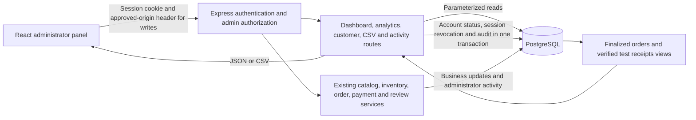

# MultiStore Phase 8 completion report

Phase 8 adds PostgreSQL-backed business reporting and customer management to the existing MultiStore admin panel. Catalog, inventory, order, payment and review management remain in the same navigation.

## Architecture



## Migration and files

- `db/migrations/007_admin_reporting.sql` creates `admin_activity`, with an optional administrator foreign key, an actor-name snapshot, action, affected record type and ID, and UTC timestamp. It adds indexes for activity, registrations, finalized orders, verified captures and recent stock movements. Two views define finalized orders and eligible test receipts. The existing `users.active` and `sessions.revoked_at` fields support account deactivation.
- `src/admin/{business,analytics,reports,reportFilters,activity}.js` implement the new API, shared date handling, SQL summaries, privacy-safe export and audit writes.
- `src/{app,auth/routes,admin/catalog,commerce/orders,payments/routes,payments/service,reviews/routes}.js` connect the migration, administrator guard and activity history to existing flows.
- `../src/App.jsx` and `../src/pages/admin/{Dashboard,BusinessDashboard,SalesAnalytics,ManageCustomers,BusinessReports,AdminActivity,businessUi}.jsx` connect the admin pages. `../src/pages/admin/Admin.css` adds responsive layouts. Recharts loads when Sales Analytics opens.
- `test/admin-business.test.js` covers authorization, PostgreSQL-backed metrics, date boundaries, reports, customer status changes and session revocation.

## Dashboard and report definitions

| Metric | Definition |
| --- | --- |
| Customers, products and categories | All registered customer accounts and all stored product/category rows, including inactive or archived records |
| Orders, completed, pending and cancelled | Finalized orders, with completed meaning Delivered and pending meaning Pending. Online payment reservations are counted separately while held and unexpired. |
| Verified Razorpay Test Mode captures | Verified captured amounts that exactly match a finalized order's currency and total. Excludes cancelled, refunded and reconciliation-required payments. Live collection is disabled. |
| Demo COD totals | Finalized, non-cancelled demo COD order totals. These are simulated and do not represent collection. |
| Unpaid online order totals | Finalized, non-cancelled online orders without a verified capture, excluding refunded, captured and unresolved potentially funded payment states. Held reservations have a separate count. |
| Inventory | Low stock means 1–5 available units. Out of stock means zero available units. Available stock subtracts reserved units and the dashboard flags active catalog entries. |
| Reviews | Published verified-purchase reviews and their average rating |
| Rankings | Units in delivered orders that used demo COD or have an eligible verified test capture. Categories use the current catalog relationship. |
| Recent lists | Up to five finalized orders, customer registrations and inventory transactions |

Analytics use inclusive date boundaries in Asia/Kolkata. Order and COD trends use order creation time, verified test captures use verification time, and registrations use account creation time. Weeks start Monday. The trend counts orders by placement date and their current status. A later cancellation or verified refund can therefore change historical reports. These summaries are operational reporting and do not serve as an accounting ledger. Monetary sums are calculated as integer paise in PostgreSQL and returned as decimal strings for exact display and CSV export.

## Administrator API

All paths below start with `/api/admin`. All require an active administrator session. The status write also requires the existing approved Origin and `X-MultiStore-Request: 1` header. Unauthenticated requests receive 401, signed-in customers receive 403, and invalid filters receive 400.

| Method and path | Parameters and response |
| --- | --- |
| GET `/dashboard` | All-time statistics and recent lists |
| GET `/analytics/sales` | `from`, `to`, `period=day\|week\|month`. Order counts, test captures, demo COD and distribution summaries. |
| GET `/analytics/products` | `from`, `to`. Top ten delivered-unit product and category rankings. |
| GET `/analytics/customers` | `from`, `to`, `period`. Registration trend. |
| GET `/customers` | `q` for name/email, `status=Active\|Inactive`, `offset`. Up to 25 accounts and the next offset. |
| GET `/customers/:id` | `offset`. Account details and paginated order history. |
| PATCH `/customers/:id/status` | JSON `{ "active": false }` or `{ "active": true }`. Repeated requests for the current status leave it unchanged. Administrator accounts cannot be targeted. |
| GET `/activity` | `q` searches actor, action and record. `offset` pages up to 25 events. |
| GET `/reports/orders` | `from`, `to`, optional order status. Dates use order creation. |
| GET `/reports/sales` | `from`, `to`, optional grouping period. |
| GET `/reports/inventory` | `from`, `to`, `status=Added\|Removed`. Movement date and current stock snapshot. |
| GET `/reports/products` | `from`, `to`, `status=Active\|Inactive`. Dates use product creation. |
| GET `/reports/payments` | `from`, `to`, optional payment status. Dates use payment-record creation. |

Date filters accept YYYY-MM-DD and default to the last 30 India calendar days. Requests may span up to 366 days. Detailed exports over 10,000 rows return 422 and ask for a narrower filter. Exports quote cell contents, escape embedded quotes, neutralize formula-prefixed text and omit customer contacts, shipping snapshots, provider references and authentication data.

Deactivation revokes existing sessions atomically. Reactivation permits a new login and leaves revoked sessions revoked. The customer status endpoint accepts only a boolean active field. Activity history starts after migration 007 and records administrator category/product changes, stock adjustments, order transitions, customer status changes, review moderation and payment reconciliation. The audit history stores record IDs and administrator identity without credentials or payment secrets.

## Run locally

Use the database and environment setup in [the backend guide](README.md). From the repo root, run:

```text
npm ci
npm run db:migrate
npm run db:seed
npm run api
```

In a second terminal run `npm run dev`. Sign in with an administrator provisioned using the [authentication guide](AUTHENTICATION.md), then open `/admin`. Run `npm run test:api` against a dedicated migrated and seeded test database, and `npm run build` for production assets.

## Verification

- A disposable PostgreSQL database applied migrations 001–007. A second migration run made no changes. Two seed runs inserted 475 and then zero new products, respectively, across 19 seed categories.
- All 30 automated API tests passed. They include existing catalog, inventory, authentication, commerce, payment-state and review regressions. Phase 8 tests cover administrator authorization, the India midnight boundary, daily/weekly/monthly buckets, refund and cancellation exclusions, unpaid amounts, export privacy and formula safeguards, and account deactivation with two existing sessions.
- A follow-up API check confirmed persisted activity events across product, category, stock, order, customer, review and payment scenarios.
- Chrome verified customer checkout, cart clearing, receipt refresh and profile totals at ₹16,863. It opened the five new admin views, rendered seven charts, switched grouping periods, exercised date empty states and customer status changes, downloaded an order CSV, and filtered activity. The five admin views fit a 390 px viewport without horizontal page overflow.
- The Vite production build passed. Lint exited successfully with warnings for unused storefront declarations and mixed React Fast Refresh exports.

Screenshots use a disposable database and a synthetic customer who placed a demo COD order. [Dashboard](../phase8-screenshots/dashboard.png) · [Analytics](../phase8-screenshots/sales-analytics.png) · [Customers](../phase8-screenshots/customer-management.png) · [Reports](../phase8-screenshots/csv-reports.png) · [Activity](../phase8-screenshots/activity-history.png) · [Mobile analytics](../phase8-screenshots/analytics-mobile.png).

External Razorpay Test Mode checkout, webhooks and refunds remain open on the [final testing checklist](../TESTING_CHECKLIST.md). Phase 9 can begin after approval.
