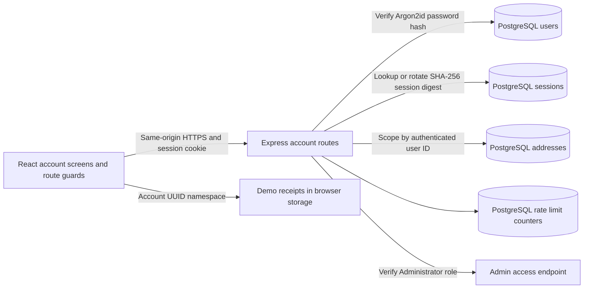

# MultiStore Phase 3 — user management and authentication

The browser-order transition below describes Phase 3. See the [Phase 5 commerce guide](COMMERCE.md) for current cart and order storage.

## Architecture



The server issues a random 256-bit opaque session cookie at registration and login. PostgreSQL stores only its SHA-256 digest. Login revokes any session presented with the request and issues a new one. Logout revokes the current session and clears the cookie. Sessions expire after eight hours. Password changes require the current password, revoke all sessions for the account, then issue a replacement for the current device. The cookie is HttpOnly and SameSite=Lax. Production requires HTTPS and a Secure, host-prefixed cookie. React restores identity from `GET /api/auth/me` before rendering protected routes.

Passwords use Node's built-in Argon2id with a random 16-byte salt, 19 MiB of memory, two passes, and one lane. The API sends only public user fields. Login is rate-limited by IP and normalized email through PostgreSQL counters. Registration is limited by IP, and password verification for sensitive account changes is limited by user ID. Unsafe account requests require an exact allowlisted `Origin` and the custom `X-MultiStore-Request: 1` header. Cross-origin clients must pass the credentialed CORS preflight. SQL queries bind user values as parameters. Address queries bind both the authenticated owner and address ID. [OWASP password storage](https://cheatsheetseries.owasp.org/cheatsheets/Password_Storage_Cheat_Sheet.html) · [OWASP CSRF prevention](https://cheatsheetseries.owasp.org/cheatsheets/Cross-Site_Request_Forgery_Prevention_Cheat_Sheet.html)

## Local setup

1. Install a current Node.js 24 LTS release with `node:crypto` Argon2 support. For a permanent PostgreSQL installation, follow the [Windows database setup](README.md#setup-on-windows) and create the ignored `server/.env` from `server/.env.example`.
2. Run from the repository root. Use `npm` in place of `npm.cmd` on macOS or Linux.

   ```powershell
   npm.cmd ci
   npm.cmd run db:migrate
   npm.cmd run db:seed
   npm.cmd run test:api
   ```

3. Start `npm.cmd run api` and `npm.cmd run dev` from separate terminals. Use the same browser hostname throughout a session. `localhost` and `127.0.0.1` have separate cookies. Add the frontend's exact origin, including its port, to `FRONTEND_ORIGINS` if Vite uses a nondefault port. To preview production assets locally, run `npm.cmd run build` followed by `npm.cmd run preview` while the API is running.
4. For a deployed site, configure the HTTPS reverse proxy to forward same-origin `/api/*` calls, set `NODE_ENV=production`, set `COOKIE_SECURE=true`, and list the deployed HTTPS origin in `FRONTEND_ORIGINS`. The default `TRUST_PROXY_HOPS=0` uses the direct connection address for limits. Set an exact hop count only when the trusted ingress strips or replaces client-supplied forwarding headers and the backend cannot be reached by another route.

### Initialize the administrator

Use the local database operator command. Public registration always creates customers. Choose an unused account email and enter a strong password through a masked prompt in PowerShell 7. The password stays out of the command line and repository.

```powershell
$env:MULTISTORE_ADMIN_EMAIL = Read-Host 'Administrator email'
$env:MULTISTORE_ADMIN_PASSWORD = Read-Host 'Administrator password' -MaskInput
try { npm.cmd run db:create-admin }
finally {
  Remove-Item Env:MULTISTORE_ADMIN_PASSWORD -ErrorAction SilentlyContinue
  Remove-Item Env:MULTISTORE_ADMIN_EMAIL -ErrorAction SilentlyContinue
}
```

The command optionally reads `MULTISTORE_ADMIN_NAME` and fails without changing an account if the email already exists. Sign in at `/login` and open `/admin`. No administrator is created by the catalog seed.

## Database migration

`server/db/migrations/002_authentication.sql` adds a validated phone column to the existing `users` table and creates the indexed `auth_attempts` table. Existing `sessions` and `addresses` retain their user foreign keys. Phone is optional at the schema level for existing records and administrator provisioning. The customer registration API requires a 10-digit phone number. The authentication endpoints require the latest migration. `GET /api/health` checks both catalog and auth tables.

## Endpoints

All paths below start with `/api`. Mutations require the Origin and custom header described above. JSON body keys are allowlisted. Account and address responses are marked `Cache-Control: no-store`.

| Method and path | Successful response | Notes |
|---|---|---|
| `POST /auth/register` | `201 {user}` and session cookie | `name`, `email`, `phone`, `password` (12–128 characters); duplicate email returns 409. |
| `POST /auth/login` | `200 {user}` and new session cookie | `email`, `password`; incorrect credentials return 401. |
| `POST /auth/logout` | `204` and cleared cookie | Idempotent. |
| `GET /auth/me` | `200 {user}` | An active session is required. |
| `PATCH /users/me` | `200 {user}` | Optional `name`, `phone`, `email`; an email change requires `currentPassword`. |
| `PATCH /users/me/password` | `204` and replacement cookie | `currentPassword` and `newPassword`. |
| `GET /addresses` | `200 {addresses}` | Lists only the signed-in customer's addresses. |
| `POST /addresses` | `201 {address}` | `recipient`, `phone`, `addressLine`, optional `locality`, `city`, `state`, six-digit `pincode`. |
| `PATCH /addresses/:id` | `200 {address}` | Partial update. An absent or other-account ID returns 404. |
| `DELETE /addresses/:id` | `204` | An absent or other-account ID returns 404. |
| `GET /admin/access` | `200 {allowed:true}` | The server returns 401 for guests and 403 for customers. The React admin layout waits for a positive check. |

`user` includes `id`, `name`, `email`, `phone`, and `role`. Validation errors use the existing `{error:{code,message,requestId}}` envelope. Rate limits return 429.

## Browser order transition

The app discards the legacy mock identity key. It does not import or display the old shared `orders` array. New demo orders use `multistore:orders:<authenticated UUID>` and are read only when their owner field matches the signed-in UUID. Switching users hides the previous user's receipt and order history, including on the same browser. Signing back into the same account restores its browser demo receipts. Legacy order data remains in the old browser key, outside the new account flow.

Browser orders remain editable through browser tools and are device-local. The admin screens have no cross-customer local order visibility and still show demo data for the signed-in account. Cart, admin product edits and stock changes remain frontend demo behavior. Saved addresses are managed in Profile. Checkout still uses the existing address-entry flow. Payment integration, cross-device orders and backend cart/checkout mutations belong to later phases.

## Verification

- A disposable native PostgreSQL 18.3 cluster ran the foundation and authentication migrations. The migration rerun reported an up-to-date schema. The administrator command provisioned a test administrator using an ephemeral secret.
- All 10 API tests passed. Authentication coverage includes invalid input, duplicate email, customer/admin authorization, hashed password and session storage, cookie attributes, CSRF, rate limiting, profile edits, password change, session expiry, logout, address edits and rejection of a second user's address writes. The six catalog tests passed in the same run.
- Chromium verified registration, login, logout, refresh persistence, profile and address changes, live administrator access, the PostgreSQL catalog, and the ₹16,863 checkout and refreshed receipt. A second signed-in customer could not open the first customer's receipt. The 390 px emulated mobile viewport checks covered login, registration and profile. Browser captures are in [phase3-screenshots](../phase3-screenshots/).
- The Vite production build passed. Lint reported 11 existing warnings and no errors. Production HTTPS was not deployed for this verification. The API tests checked the production cookie attributes, and browser runs used local HTTP.
