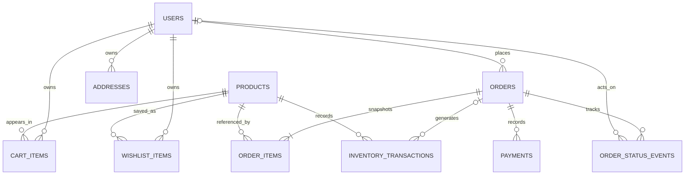

# MultiStore Phase 5 — carts, wishlists and orders

Phase 5 used Demo Cash on Delivery only. See the [Phase 6 payments guide](PAYMENTS.md) for the current online checkout and reservation behavior.

## Setup

Use the [database setup guide](README.md#setup-on-windows) for a permanent PostgreSQL instance and the [administrator setup guide](AUTHENTICATION.md#initialize-the-administrator) for administrator access. Run the migration before starting the API. On an existing database the migration preserves catalog and account records. Run the seed for a fresh development database.

```powershell
npm.cmd ci
npm.cmd run db:migrate
npm.cmd run db:seed
npm.cmd run api
# In a second terminal
npm.cmd run dev
```

Run `npm.cmd run test:api` against a **disposable seeded development database**. The rollback test installs and removes a test trigger in that database. The suite runs serially because catalog and commerce tests share fixture data.

## Database relationships

Migration `004_commerce.sql` adds Pending to order statuses, the checkout request digest and discount snapshot to orders, an image snapshot to order items and Cancelled to payment statuses. It creates the order status journal. The existing cart and wishlist composite keys enforce one line per account and product. The existing unique checkout key is scoped to its account.



Order items save names, quantities, selling prices and primary image URLs. Orders save the shipping address, server-calculated amounts and timestamps. The related payment row stores payment status. Future edits to addresses or products do not change those snapshots.

## API

All paths start with `/api`. Require a server session. Administrator paths require the administrator role. Writes use the Phase 3 Origin and CSRF header checks. All monetary amounts are integer paise. Requests containing unexpected pricing fields are rejected.

| Method and path | Purpose |
|---|---|
| `GET /cart` | Current lines, their availability, totals and the quote version |
| `POST /cart/items` | Add `{productId,quantity}` and return updated cart |
| `PATCH /cart/items/:id` | Set absolute `quantity` for the supplied product ID |
| `DELETE /cart/items/:id` | Remove a line from the caller's cart |
| `DELETE /cart` | Clear the caller's cart |
| `GET /wishlist` | List saved products, including any that became unavailable |
| `POST /wishlist/items` | Add a product by `productId`; repeated additions deduplicate |
| `DELETE /wishlist/items/:id` | Remove a saved product |
| `POST /wishlist/items/:id/move` | Move one unit into cart, then remove the saved item in the same transaction |
| `POST /checkout` | Place an order with `quoteVersion`, UUID `idempotencyKey` and either `addressId` or `address`; returns `{orderId}` |
| `GET /orders` | Paginated customer order history |
| `GET /orders/:id` | Owner-scoped receipt and status timeline |
| `POST /orders/:id/cancel` | Cancel an eligible order owned by the caller |
| `GET /admin/orders` | Paginated order search by number, UUID, customer name or email; accepts `q`, `status` and `offset` |
| `GET /admin/orders/summary` | Total order count and captured payment sum |
| `GET /admin/orders/:id` | Order, shipping, customer, status events and payment status |
| `PATCH /admin/orders/:id/status` | Apply an allowed `status` transition with recorded actor |

The new-address payload uses `recipient`, `phone`, `addressLine`, optional `locality`, `city`, `state` and `pincode`. A saved address must belong to the caller. Another customer's order returns 404. Duplicate checkout requests with the same key and request return the existing order (200). A reused key with a changed request is rejected (409). Changed prices, quantities or unavailable stock also generate a conflict. Checkout uses the committed order receipt after a refresh.

## Pricing and transaction rules

Shipping is ₹40 on nonempty carts with a selling-price subtotal up to ₹500, and free above ₹500. Checkout calculates every line and total from PostgreSQL. The opaque quote version lets it detect a changed cart. It never supplies a price. Product quantities are limited to 999 per line and 100 distinct cart products.

Checkout serializes changes to the account's cart, locks product rows in ID order, checks category availability, recalculates the quote, and inserts the order, item snapshots and demo payment row. The same transaction deducts stock, records inventory movements and the initial status, and clears purchased lines. Any failure rolls back the whole operation.

Pending may move to Processing or Cancelled. Processing may move to Shipped or Cancelled. Shipped may move to Delivered. Delivered and Cancelled are terminal. Customers can cancel their own Pending or Processing orders. A cancellation locks the order and restores stock once using uniquely keyed inventory events. Both the customer and admin views show recorded statuses and timestamps.

The only checkout method is **Demo Cash on Delivery**. It never collects funds or card data. The unpaid demo payment remains Pending even on Delivered orders and becomes Cancelled on cancellation. Dashboard revenue counts captured payments only. Phase 6 can add provider-backed payment attempts and verification.

## Transition and scope

Shopping actions require sign-in. Catalog browsing remains public. Cart and wishlist records load from PostgreSQL after sign-in and refresh, so the same account can use another browser. The app no longer reads or writes the legacy browser shopping cart and demo-order keys. Existing values are left inert without assigning them to an account. No legacy order is imported or counted in administration.

Order tracking shows recorded fulfillment states. Payment-provider integration and review-module work are outside this phase.

## Verification

- All four migrations applied on disposable native PostgreSQL. A second migration run reported the database was up to date, and reseeding inserted no duplicate products.
- All 17 integration tests passed. The suite exercised two sessions on the same account, quote changes, rejected frontend prices, duplicate checkout, competing purchases for the final unit, cancellation races, historical snapshots and a forced database failure after stock deduction. The prior authentication and catalog suites passed in the same run.
- Chromium on the production build verified saved and new addresses, wishlist-to-cart movement, sign-in persistence, the ₹16,863 and ₹686 checkout scenarios, refreshed receipts, order history, cancellation and restock, cross-account denial, and admin status updates. Cart, checkout, receipt and admin orders fit a 390 px emulated viewport. Physical devices and a deployed environment were outside this test.
- The Vite production build passed. Lint reported 11 warnings and no errors. Browser captures are in [phase5-screenshots](../phase5-screenshots/).
