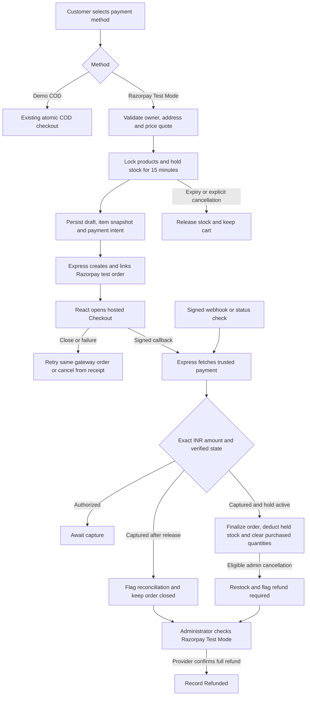

# MultiStore Phase 6 — Razorpay Test Mode

## Setup and verification with a Razorpay account

1. Follow the [PostgreSQL setup guide](README.md#setup-on-windows). Run `npm.cmd ci` and `npm.cmd run db:migrate`. Run `npm.cmd run db:seed` for a fresh database. Use the account bootstrap instructions in [Authentication](AUTHENTICATION.md#initialize-the-administrator) to access the admin interface.
2. Sign in to the Razorpay Dashboard, select **Test Mode**, and generate a matching test API key ID and secret in the API Keys settings. Use the account's supported test instruments and configure automatic capture in Test Mode. The app verifies capture with Razorpay and leaves an authorization pending. [Razorpay Standard Checkout setup](https://razorpay.com/docs/payments/payment-gateway/web-integration/standard/integration-steps/) · [Test payment instruments](https://razorpay.com/docs/payments/payments/test-card-details/)
3. Put `RAZORPAY_KEY_ID`, `RAZORPAY_KEY_SECRET` and `RAZORPAY_WEBHOOK_SECRET` in the ignored `server/.env`. The key ID must start with `rzp_test_`. Use a separate webhook signing secret. Keep both secrets on the server. The browser receives only the public key ID and parameters for the order. Missing entries or a live-mode key disable online checkout while keeping Demo Cash on Delivery available.
4. In the Razorpay Test Mode webhook settings, register a public HTTPS URL ending with `/api/payments/razorpay/webhook`. Forward exactly that route to Express without rewriting its request body. Subscribe to `payment.authorized`, `payment.captured`, `payment.failed`, `order.paid` and `refund.processed`. Use an HTTPS staging host or a controlled tunnel to the backend for a local callback. Razorpay cannot call a loopback-only URL. Put the same signing secret in `server/.env`. [Validate and test Razorpay webhooks](https://razorpay.com/docs/webhooks/validate-test/)
5. Start `npm.cmd run api` and `npm.cmd run dev` from separate terminals. Sign in, open checkout and select **Razorpay Test Mode**. Exercise success, failure and dismissal with official test instruments. Confirm the receipt and admin record match the Razorpay Test Mode dashboard. For a deployed CSP, allow the domains required by Razorpay Standard Checkout and test the hosted payment methods before relying on that deployment.

Use `npm` instead of `npm.cmd` on non-Windows shells. The disposable browser mock used for developer verification is separate from the app's deployment configuration.

## Architecture and lifecycle

- PostgreSQL separates physical on-hand stock from reserved stock. Catalog and cart availability subtract reservations. Inventory adjustments cannot reduce physical stock below the reserved quantity.
- The online attempt is persisted before the gateway call. An account can hold one active reservation. The same checkout key reuses its linked provider order. An ambiguous create response is recorded as `CreationUnknown`; the app does not send another create call for that intent. A signed webhook can recover the link using the verified gateway receipt, or an administrator can attach a matching order ID. The reservation still expires after 15 minutes.
- The hosted callback signs the stored Razorpay order ID and payment ID. Express compares the signature in constant time, fetches the payment directly from Razorpay, and checks payment ID, linked order ID, INR, integer amount and capture status. The browser supplies neither a price nor an authoritative status.
- Verified capture before expiry consumes the reservation, reduces physical stock once, adds the inventory ledger and status records, and removes purchased quantities in one database transaction. Extra cart quantities are retained. Browser dismissal preserves a retryable payment window. Explicit eligible cancellation or expiry releases it. The API process sweeps expired holds every 30 seconds and relevant customer requests also sweep their expired holds.
- Webhooks are signed over unparsed bytes, deduplicated by event ID, and reconciled using current provider data. Failure can remain retryable. A late capture never reopens fulfillment. It gets `ReconciliationRequired` for administrator review even if the cart or product changed. A paid order needs administrator cancellation before shipping. The app restores stock and marks `RefundRequired`. Perform any needed full refund in the Razorpay **Test Mode** dashboard, then verify with **Check Gateway Status** or the signed refund webhook. The app records `Refunded` only when provider data confirms a matching full refund. Partial refunds require administrator review. [Razorpay payment fetch API](https://razorpay.com/docs/api/payments/fetch-with-id/) · [Razorpay refund documentation](https://razorpay.com/docs/api/refunds/create-normal/)
- Razorpay failures, expiry, cancellation and reconciliation preserve the order audit trail. The app stores a payment record per gateway order and updates it to the latest verified outcome. It does not store gateway raw bodies, customer payment credentials, card numbers, or CVV codes.

## Schema and endpoints

Migration `005_razorpay.sql` adds `products.reserved_stock`, online payment and reservation state on orders, verification metadata and gateway uniqueness constraints on payments, and the webhook event journal. Existing orders are marked as finalized historical COD orders. The existing products, order item snapshots and inventory movement relationships remain.

All paths are under `/api`. Customer endpoints use session ownership. Administrator endpoints require the server-side administrator role. State changes use the existing CSRF checks except the standalone, signature-authenticated server webhook.

| Method and path | Purpose |
|---|---|
| `GET /payments/razorpay/config` | Returns online availability for checkout |
| `POST /payments/razorpay/order` | Validate the price quote and shipping, reserve stock, and return test Checkout parameters. Accepts the same address, quote version and UUID idempotency fields as COD. |
| `POST /payments/razorpay/:id/resume` | Return the existing provider order's parameters while the hold is eligible |
| `POST /payments/razorpay/verify` | Verify the callback signature and reconcile with Razorpay's payment data |
| `POST /payments/razorpay/webhook` | Verify raw bytes, observe provider state and deduplicate the event |
| `GET /orders/:id/payment` | Read the caller's order payment record |
| `POST /orders/:id/payment/check` | Fetch current trusted Razorpay status for the caller's linked order |
| `GET /admin/payments` | Paginated payments list filtered by `q`, `status` and `offset`. Search supports internal order, payment or Razorpay identifiers. |
| `POST /admin/payments/:id/reconcile` | Verify current gateway status, optionally recover a missing link with a verified `providerOrderId` |
| `POST /checkout` | Existing Demo Cash on Delivery checkout |

**Refund operations.** MultiStore does not issue refunds automatically. The admin view flags eligible records for action and verifies provider status. Check pending and reconciliation records before using a shared test account for another demonstration. No reviews or ratings changes are included.

## Verification

- All five migrations applied to disposable native PostgreSQL. The second migration run made no changes. All 22 integration tests passed, including the preceding catalog, authentication and commerce suites.
- Mocked SDK tests covered order creation, ₹16,863 and ₹686 amounts, failures and retry, reservation cancellation and expiry, concurrent final-unit reservations, signature and amount checks, cross-account rejection, duplicate and out-of-order webhooks, refund verification, and rollback and retry after a forced database failure during online finalization.
- Chromium on the built app used a local widget fixture clearly labeled **Mock Razorpay Checkout**. Dismissal, failure, retry, verified ₹16,863 receipt and refresh all passed. The ₹686 Demo Cash on Delivery checkout passed. Checkout, online receipt and admin payments fit an emulated 390 px viewport. The production build passed, and lint reported 11 warnings and no errors. Captures are in [phase6-screenshots](../phase6-screenshots/).
- Razorpay credentials and a webhook secret were unavailable for this run. The actual hosted Test Mode widget, a real Razorpay test order and transaction, external webhook delivery, and provider refund confirmation remain unverified. The local fixture generated no Razorpay transactions.
